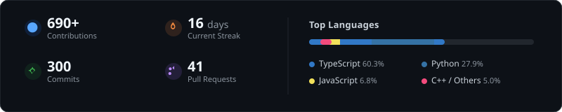

# Hi, I'm Pranay 👋

**Building intelligent systems that move from research to real-world deployment.**

`Autonomous Agents` &nbsp;•&nbsp; `Edge Computer Vision` &nbsp;•&nbsp; `LLM Evals` &nbsp;•&nbsp; `Systems`

---
- Leading **Optisense AI** — vision-sensing prototype  for production
- Researched at the **Visual Intelligence and Learning Lab, IIT Hyderabad**

  

